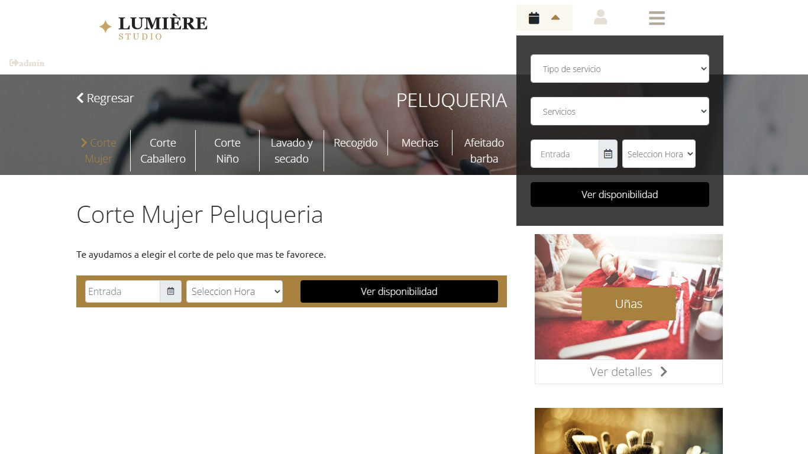
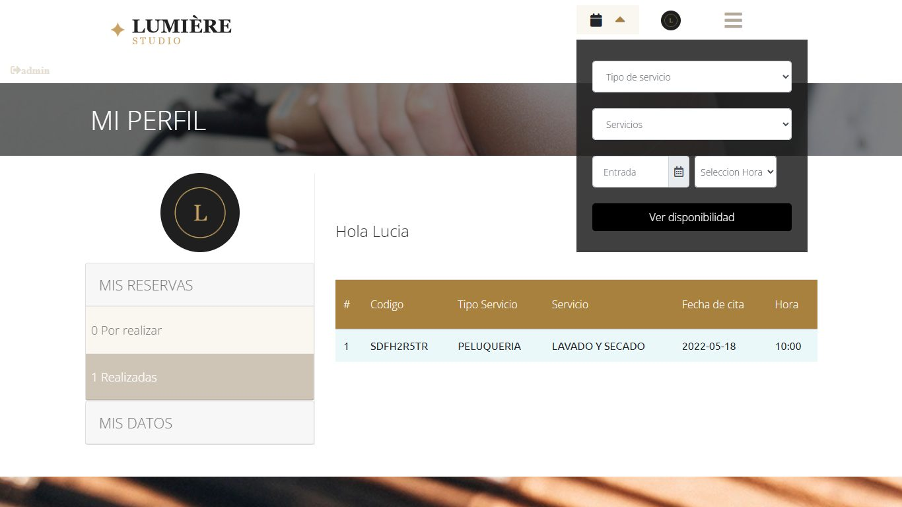
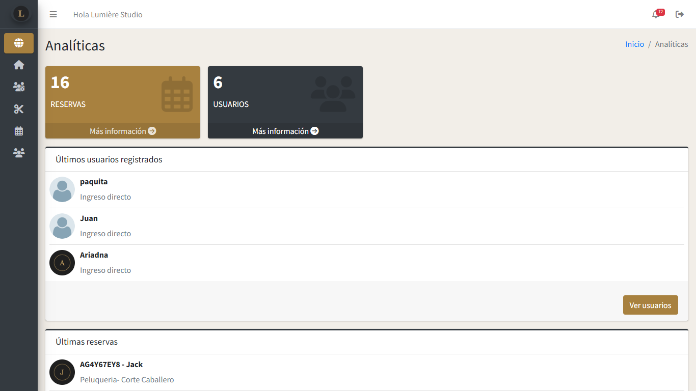
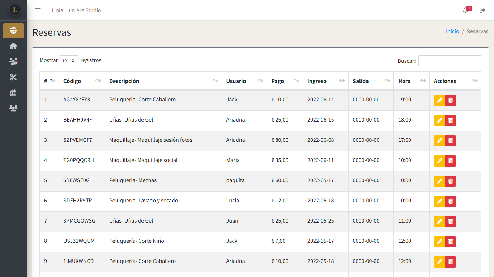
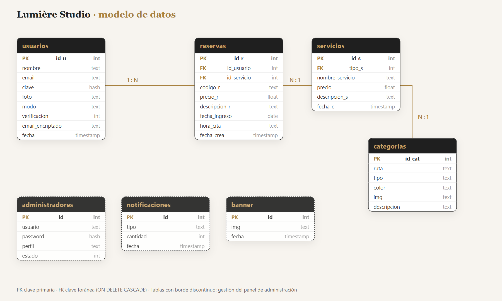

# Lumière Studio · Beauty Center Booking System

Web application for a beauty center (hair, nails, makeup): customers browse services and book appointments online, and staff manage services, bookings and users from an admin panel.

Final project of my **Web Application Development degree (DAW, 2022)**, built in **PHP with a hand-written MVC architecture** and **MySQL**. In 2026 I revisited it to bring it up to current standards: security hardening, PHP 8 compatibility, environment-based configuration, a Docker setup and a new visual identity.

> The user interface is in Spanish.


## Features

**Public site**
- Service catalog by category (hair, nails, makeup) with prices and descriptions.
- Online booking with availability check by date and time (AJAX) and a unique booking code.
- Sign-up with email verification, login, password recovery by email.
- Customer profile: upcoming and past bookings, profile photo, password change.
- Contact form.

**Admin panel** (`/backend`)
- Dashboard with totals, latest bookings and new users.
- CRUD for services, bookings (calendar view), users and administrators.
- Roles (Administrator / Editor) and account activation.
- Notifications for new bookings.

| Service page | Customer profile |
|---|---|
|  |  |

| Admin · dashboard | Admin · bookings |
|---|---|
|  |  |

## Architecture

```
index.php / backend/index.php     Front controllers
├── controladores/                Controllers (request handling, validation, sessions, email)
├── modelos/                      Models (PDO prepared statements)
├── vistas/                       Views (PHP templates, JS, CSS)
├── ajax/                         AJAX endpoints used by the views
├── config.php                    Configuration from environment variables
└── database/lumiere_studio.sql   Schema + demo data
```

- **MVC** without a framework: each request goes through a controller, which calls a model and renders a view.
- **Friendly URLs** with Apache `mod_rewrite` (`.htaccess` → `index.php?pagina=...`).
- **Normalized relational schema** (users, services, categories, bookings, admins, notifications).



## Security improvements (2026 revision)

| Before | After |
|---|---|
| Database credentials hard-coded in the source | Configuration from environment variables / `config.local.php` (git-ignored) |
| `crypt()` with a fixed salt for every password | `password_hash()` / `password_verify()` (bcrypt, random salt) |
| Admin AJAX endpoints reachable without login | Every admin endpoint requires an admin session |
| Email-check endpoint returned the full user row (including the password hash) | Returns only whether the email exists |
| Admin edit form sent the password hash to the browser | Hash never leaves the server |
| Password change and photo upload trusted a user ID sent by the form | User ID taken from the session |
| Database values printed without escaping | Output escaped with `htmlspecialchars` (XSS) |
| Session ID kept after login | `session_regenerate_id()` on login |
| `mt_rand()` for temporary passwords | `random_int()` |
| Code incompatible with PHP 8 | Runs on PHP 8.2 |

## Tech stack

PHP 8 · MySQL / MariaDB · PDO · JavaScript (jQuery, AJAX) · Bootstrap · AdminLTE · PHPMailer · Apache · Docker

## Run it locally

### With Docker (recommended)

```bash
docker compose up --build
```

| Service | URL |
|---|---|
| Website | http://localhost:8080 |
| Admin panel | http://localhost:8080/backend |
| Test inbox (verification and recovery emails) | http://localhost:8025 |

### With XAMPP

1. Copy the project into `htdocs/lumiere-booking`.
2. Create a database `lumiere_studio` and import `database/lumiere_studio.sql`.
3. Copy `config.example.php` to `config.local.php` and adjust the values.
4. Install dependencies: `cd extensiones && composer install`.
5. Open http://localhost/lumiere-booking/

### Demo accounts

All demo accounts use the password **`Demo1234`**.

| Area | User |
|---|---|
| Admin panel | `admin` (Administrator) · `editor` (Editor) |
| Customer | `lucia@example.com` |

## Credits

Photos: public domain (CC0) images from [rawpixel](https://www.rawpixel.com/) via [Openverse](https://openverse.org/). Team and testimonial avatars are generated monograms.

## Author

**Leslie Carolyn** · [Portfolio](https://lyn-devstack.github.io/lyn-portfolio/) · [LinkedIn](https://www.linkedin.com/in/carolyn-lyn-dev) · [GitHub](https://github.com/lyn-devstack)
